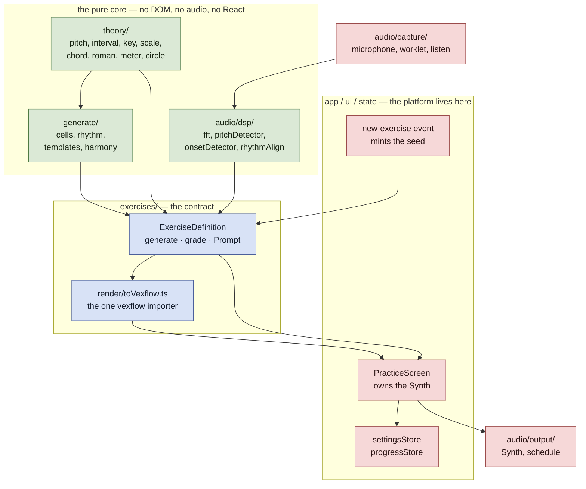
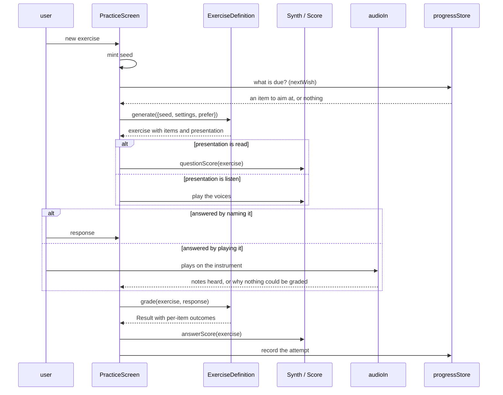
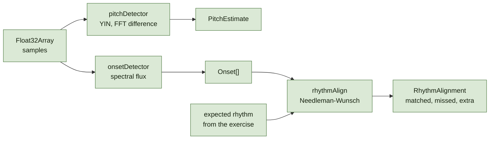

# Architecture

A practice app for musicians. It generates an exercise, puts it to the user
either on the staff or through the speaker, listens to them play it on a real
instrument, and records what that says about the things they are learning.

This document describes the shape as it stands. Decisions that would be
expensive to reverse live in [`docs/adr/`](adr/README.md) and are linked from
here; where the two disagree the ADR is the record of what was decided and this
file is what is true today.

## Contents

- [The one constraint](#the-one-constraint)
  - [How the boundary is kept](#how-the-boundary-is-kept)
- [What happens when the user practises](#what-happens-when-the-user-practises)
- [The exercise contract](#the-exercise-contract)
  - [Presentation](#presentation)
- [What an attempt records](#what-an-attempt-records)
- [Two tables keyed on the item id](#two-tables-keyed-on-the-item-id)
- [Persistence](#persistence)
- [The analysis chain](#the-analysis-chain)
- [Generation](#generation)
- [What is not built](#what-is-not-built)

## The one constraint

Three directories — [`src/theory/`](../src/theory), [`src/generate/`](../src/generate)
and [`src/audio/dsp/`](../src/audio/dsp) — import nothing from the layers above
them and nothing from the platform. No DOM, no `AudioContext`, no React, no
persistence. They take plain data and return plain data
([ADR 0001](adr/0001-a-pure-core.md)).

That is roughly half the codebase, and it is the half where every interesting
claim lives: whether a Db melodic minor is spelled correctly, whether a
generated progression cadences, whether YIN finds the right fundamental in a
recorded note. All of it runs under vitest on a laptop in milliseconds, with no
browser and no microphone, which is what makes property tests over thousands of
seeds affordable rather than aspirational.



Every arrow is wired. Capture was the last one, and it was dotted here for
long enough to be worth saying what closed it: a microphone opens its own
`AudioContext`, a worklet hands frames to the analysis chain, and
[`AudioIn`](../src/exercises/types.ts) puts the result in front of a prompt as
one of two answers — notes, or a reason nothing could be graded
([ADR 0047](adr/0047-hearing-nothing-and-not-hearing-are-different-answers.md)).
Two exercises take it today, interval and scale identification:

```bash
grep -rln 'audioIn.listen' src/exercises/*/[A-Z]*.tsx
```

### How the boundary is kept

It is a convention, not a module boundary — nothing in TypeScript stops a
branch importing `document` into the generator. So it is asserted instead, by
[`src/architecture.test.ts`](../src/architecture.test.ts), which walks the
filesystem (an untracked file breaches the rules too), blanks comments before
scanning (the rules match prose otherwise), and asks all three records of the
repository on every run.

That file has carried three defects of its own, each of which let through the
breach it existed to stop, and each found by mutating a *branch* of a rule
rather than the rule. It is worth treating as code that needs testing rather
than as the thing that does the testing.

## What happens when the user practises

The seed is minted above the core, at the moment the user asks for a new
exercise, and handed in ([ADR 0005](adr/0005-seeds-are-minted-outside-the-core.md)).
Everything downstream of it is a pure function of its inputs
([ADR 0002](adr/0002-generation-is-reproducible-from-its-seed.md)), and since
18 October those inputs are `(seed, settings, wish)`: the schedule now names
the item the next question should aim at, and an exercise that can aim takes
it. So a seed alone no longer rebuilds the question for the five types that
aim — which is why the wish is stored on the attempt beside the seed, and a
reported *attempt* still reproduces exactly.



`generate` and `grade` are both pure and both live outside the component.
Keeping `grade` out of an `onClick` is what makes it property-testable, and it
is where every claim an exercise makes actually sits.

The listening is the prompt's own call and not the screen's: the screen hands
`audioIn` down, and the exercise says what counts as enough to grade, because
nothing below it can — two notes answer an interval, a run reaching the octave
answers a scale, and neither is a fact about a microphone.

## The exercise contract

[`src/exercises/types.ts`](../src/exercises/types.ts) says what an exercise type
is, as a contract rather than a convention. Seven exist across six families —
intervals and scale degrees are two ways of asking note identification, and
then chord progression, key, chord, scale and rhythm — and sight reading is the
one in the brief still unwritten. The intent was that each new one cost almost
nothing, and so far each has.

```bash
./tools/report-facts.sh | grep -E '^exercises|^families'
```

The seams it defines:

| Seam | Why it is a seam |
| --- | --- |
| `generate(spec)` | Takes `(seed, settings)` and nothing else, so an exercise is reproducible |
| `grade(exercise, response)` | Pure, so it can be property-tested away from the UI |
| `settings.fields` | A *description* of the settings, so one generic panel serves every type |
| `settings.coerce` | Total function from `unknown`, because stored settings outlive the release that wrote them |
| `Prompt` | The only per-exercise component; handed audio rather than reaching for it |
| `questionScore` / `answerScore` | Engraving stays on the definition, so the parts of an exercise that are not components never import `ui/` |
| `items(settings)` | Everything these settings make askable, which the scheduler needs and the attempt log cannot supply |

The last one is load-bearing for [ADR 0003](adr/0003-one-importer-for-the-notation-library.md).
A prompt that rendered its own stave would make `exercises/` import `ui/` import
`exercises/render/`, and the containment is easiest to keep while that arrow
points one way.

**One exercise draws its own staves, and the rule is narrower than it looks.**
Rhythm identification sets `promptDrawsScores`, so the screen draws neither
stave and hands both specs down; its prompt needs the stave to *move*, with a
cursor on the audio clock and the notes coloured by how they were played. That
prompt imports `Score`, so `exercises/` does reach into `ui/` in exactly one
place. [ADR 0029](adr/0029-a-prompt-is-a-component-and-may-use-one.md) settles
it: the rule that matters is that an exercise's **non-component** code —
`generate`, `grade`, the settings schema, `items` — stays free of the UI, which
is what keeps it testable with no DOM. A `Prompt` was always a component.

The engraver reports where it put each note, as a `ScoreLayout`, rather than
letting the UI measure the drawn SVG. 0029 has the argument; the short version
is that counting noteheads in the DOM goes off by one the first time a rest or
a tuplet bracket adds an element, and that it would put VexFlow-shaped
knowledge in `ui/` **while importing nothing**, so ADR 0003's guard would keep
passing as the containment it exists for eroded.

That containment pays for itself twice. It was written so the renderer stays
replaceable; it also turns out to be what makes VexFlow's weight removable from
the first paint. The notation chunk is most of the JavaScript the app ships and
most of *it* is the Bravura font — 377 kB gzipped against 465 kB in total when
this was measured, at `f883e1f` on 4 October — and **exactly one runtime import
reaches it**: [`Score.tsx`](../src/ui/notation/Score.tsx) importing `drawScore`.
Every other reference is `import type` and is erased at compile time. The
proportion is the load-bearing part and it is not quoted again below; the
single importer is asserted rather than remembered, by
[`src/architecture.test.ts`](../src/architecture.test.ts).

```bash
npm run build && ./tools/report-facts.sh | grep '^bundle'
```

So there is one edge to make dynamic, inside an effect that already runs
imperatively and already has a failure path. Had VexFlow leaked into those six
screens there would be six await points and no practical split. A dynamic
`import('vexflow')` inside `toVexflow.ts` keeps the file the sole importer, and
the guard's scanner already matches dynamic specifiers, so the rule in ADR 0003
continues to be enforced unchanged.

Two consequences are not free. The first engrave gains a load it did not have,
so the staff needs a placeholder rather than nothing. And `Score.tsx` currently
treats any throw as "the engraver could not lay out this spec", which is a
generator bug worth showing; a chunk that fails to load is a different failure
and would be reported as the first. That matters more than it sounds for an
app meant to be installable: **a lazily loaded chunk has to be precached by the
service worker or the app breaks offline**. That was open while
`vite-plugin-pwa` sat in `package.json` as a dependency `vite.config.ts` never
imported. It is wired now, and the obligation is asserted rather than
remembered — `test.sh --offline` fails if the built service worker leaves out
anything the app needs, the notation chunk and its font included.

```bash
./test.sh --offline
```

**A family is a kind of practice; a type is one way of asking it.**
[`registry.ts`](../src/exercises/registry.ts) groups types into families, so
the home screen offers six kinds rather than one card per type, and the
practice screen offers a family's types in a selector. The grouping lives in
the registry rather than the menu because it is a fact about the exercises and
the menu is a view of it.

It is a grouping and not a merge, and
[ADR 0007](adr/0007-an-attempt-records-per-event-item-attribution.md) is why: a
type's id is what the attempt log stores and what every recorded item is keyed
by, so folding three types into one would orphan everything a user had learned
under the ids that disappeared. Each type keeps its id; only the presentation
changed. The cost is two id namespaces that both carry compatibility
commitments — family ids are routes, type ids are log keys — and `findFamily`
accepts either, so a bookmark made before the families existed still resolves.

**The evidence is good for adding a type and was bad for switching between
them.** Adding is cheap as advertised: the second exercise,
[`key-id`](../src/exercises/key-id), arrived as 356 lines of non-test source
and required no change to the screen, the settings panel or the attempt log —
[`registry.ts`](../src/exercises/registry.ts) gained one import and one array
entry. That line count is what it cost on the day and has grown since; the
part worth checking is the second sentence, and the registry still reads that
way for all seven.

Switching was not. The screen is generic over exercise types, which means it
holds state belonging to a *particular* type — the live question, the session
tally — while the type can change underneath it, and nothing tied that state's
lifetime to the type. Changing the exercise ran the incoming type's code
against the outgoing type's question. `key={round.id}` was the right technique
applied one level too deep, and with no error boundary anywhere in `src/` the
failure took the whole page.
[ADR 0015](adr/0015-state-keyed-to-the-exercise-type-must-not-outlive-it.md)
makes it a rule — state keyed to the type is discarded by remount, not by a
reset path that has to be kept in step — and contains the failure so a broken
exercise does not take the menu with it. A seam that is cheap to extend but
unsafe to switch between is not the seam it advertises.

One leak is closed: a card whose blurb is not listed in
[`ui/menu.ts`](../src/ui/menu.ts) now falls back to the definition's own
`description` rather than to the empty string, so a new exercise cannot ship
with a blank card.

### Presentation

Every exercise can be asked two ways: `read`, where the question is on the staff
and nothing sounds, and `listen`, where it sounds and the staff stays empty
until the answer is given. These are different skills — a learner can be fluent
at one and hopeless at the other — so it is a setting rather than a house style,
and a definition declares which senses it supports.

It is carried on the generated exercise rather than read from settings at render
time, because changing the setting mid-question must not change the question,
and because **an attempt is only comparable with another attempt asked the same
way** ([ADR 0010](adr/0010-presentation-is-part-of-what-an-attempt-means.md)).

That is now carried through: `presentation` is a named, validated field on the
stored attempt rather than something dug out of an opaque settings blob, and
[`tallyItems`](../src/state/progressStore.ts) keys on `(presentation, item)`
through `tallyKey`, so reading a third and hearing one are counted separately.
The presentation stays *outside* the `ItemId`, because ids are a compatibility
commitment and one encoding two orthogonal things cannot change along one axis
without breaking the other. Making it a field meant the app's first schema
migration, v1 to v2.

## What an attempt records

Per item, not per exercise ([ADR 0007](adr/0007-an-attempt-records-per-event-item-attribution.md)).
A sight-reading bar tests a key signature, a dozen intervals and several
rhythmic cells at once, and the user plays it once; credit and blame have to
localise or the schedule punishes six things for one wrong note.

Two lists, deliberately distinct. `Exercise.items` is everything the rendering
*contained*; `Result.outcomes` is only what the response actually *tested*.
Keeping both is what lets the schedule tell "never shown" from "shown and not
tested".

An [`ItemId`](../src/exercises/types.ts) is a colon-joined path —
`interval:m3:up`, `chord:dom7:inv2` — and keys the user's review history, which
makes it a compatibility commitment from the first release. Renaming one
silently orphans everything the user has learned about it.

## Two tables keyed on the item id

The log is not the only thing that key buys. Two tables answer a graded item
without either of them knowing what an exercise is:
[`exercises/songs.ts`](../src/exercises/songs.ts), which names tunes a learner
may already know for the interval they just missed, and
[`ui/reference.ts`](../src/ui/reference.ts), which says where in the theory
reference that item is explained so an answered question can offer a button to
it. Both were asked for by the user, in that order.

Keying on the id rather than on a second vocabulary of their own is what makes
their coverage checkable: *every entry is something an exercise can ask*, and
*every askable item either has a page or is a deliberate omission*, are sweeps
over `items(settings)` rather than hopes. A near-duplicate key would be free to
drift from the thing it describes, which for a song table means putting the
wrong contour in a learner's ear — worse than silence, because they trust it.

Each sits on the side of the boundary its content belongs to rather than where
its caller is. A song reference is pedagogy and not a fact about music, so it
is under `exercises/` and not in `theory/`: which tune somebody already knows is
a guess about the learner, where a minor third is a minor third. A reference
target is a route, which is the app's, so it is in `ui/` — and
[ADR 0029](adr/0029-a-prompt-is-a-component-and-may-use-one.md) is why it
cannot simply live beside the exercise that wants it. What crosses back is in
the receiving page's own terms — a scale id, a key id, a metre — so no
reference page parses an exercise's ids.

Both return *nothing* as a real answer: an empty hint, a null target. An id
this release does not recognise is a thing history can hold, since the log
outlives the code that wrote it, and it should cost a button rather than open
a page that claims to be about it.

The intervals page the second of these needed did not exist and now does, which
is the ordinary shape of this: a reference button is only as good as the pages
it can point at.

Split by what the data is, not by convenience
([ADR 0006](adr/0006-settings-in-localstorage-progress-in-indexeddb.md)):
settings in `localStorage`, the attempt log in IndexedDB.

Both sit behind two small interfaces in
[`persistence.ts`](../src/state/persistence.ts) — `Slot<T>` for a single value,
`Log<T>` for an append-only series. Each has a memory implementation, which is
what the app falls back to when a device will not open a database. A fallback
that behaves differently from the thing it replaces is not a fallback, so the
promises are written once in [`logContract.ts`](../src/state/logContract.ts) and
both implementations are made to keep them.

## The analysis chain

Fed by `capture/` and gradeable by two exercises. All of it is pure arithmetic
over sample arrays, which is the point — it is verified against synthesised and
recorded signals off-device rather than by playing into a laptop.



The detector is ported from the sibling `tuner` project, whose own ADRs record
what each constant was measured against. Those numbers are measurements rather
than preferences: changing one means re-running the recordings corpus, not
re-reading the code. The onset threshold floor
([ADR 0008](adr/0008-an-onset-is-a-rise-in-the-frames-own-spectrum.md)) and the
alignment ([ADR 0009](adr/0009-align-a-performance-by-dynamic-programming.md))
were decided here and have records of their own.

Aligning by dynamic programming rather than by nearest-neighbour matters because
a player who drops a note should be told they dropped a note, not have every
subsequent onset counted wrong.

Nothing here transcribes. The app generated the exercise, so it holds the
symbolic answer and the question is *does this match* rather than *what is
this* — which is score following, and is why dynamic programming against a
known reference is the right family. The judge therefore consumes performed
notes rather than audio, from either a microphone or a MIDI instrument
([ADR 0012](adr/0012-the-judge-consumes-performed-notes-not-audio.md)); Web
MIDI is unavailable on Safari and iOS, so neither source can be the only one.
Knowing the answer also means a chord localises to per-tone outcomes without
polyphonic transcription, and that an inconclusive hearing reports *no*
outcome rather than a wrong one
([ADR 0013](adr/0013-knowing-the-answer-narrows-what-judging-has-to-do.md)).

Timing is on one clock, `AudioContext.currentTime`, with a performed note's
start given in *exercise* time — seconds from the exercise's own zero
([ADR 0014](adr/0014-one-clock-and-the-latency-nobody-can-measure.md)).

**That is the rule and not yet the whole practice, and the difference is worth
stating here rather than leaving to be discovered.** The app runs two
`AudioContext`s, not one: output owns the synth's, and `capture/` opens its
own deliberately, because the rate the device gives a microphone is not the
rate chosen for playback and reading the wrong one puts every frequency 147
cents out
([ADR 0049](adr/0049-one-audiocontext-owned-by-one-module.md)'s correction has
the measurement). A note from `listen()` is accordingly timed from the start
of its take, not from either context's `currentTime`. Nothing is wrong today
because the two exercises that take audio ask about order and pitch rather
than placement — the bill falls due when a rhythm exercise is graded from the
microphone, which is the same bill the paragraph below describes.

The Web
Audio API reports `baseLatency` and `outputLatency` but has no input-latency
property, so what the microphone path costs has to be calibrated rather than
read. The size of that gap is not academic: `toleranceFor` caps the matching
window at a 100 ms half-width, which ordinary round-trip latency can consume
entirely — past which every expected note reads as missed and every played note
as extra, looking like a broken detector rather than an uncalibrated one.

## Generation

`generate/` chooses; `theory/` knows. The division is that `theory/` contains
facts that are checkable against music theory, and `generate/` contains
decisions with no single right answer.

Harmony is kept symbolic — roman numerals, realised into spelled pitches as late
as possible ([ADR 0004](adr/0004-harmony-stays-symbolic-until-it-is-spelled.md)).
A generator working in pitch classes could not know whether the middle note of
V/V in C was meant as F# or Gb, and the whole investment in spelled pitches
would be wasted at the point of use.

The generator runs in stages, and the four its own header describes are not the
four it runs — the order differs, two are unnumbered, and cadence enforcement
brackets the transformations rather than following them.
[`docs/harmony-pipeline.md`](harmony-pipeline.md) has the comparison.

Because `generate/` has no ground truth, its tests assert constraints and never
aesthetics: that a suspension resolves down by step, not that a particular seed
produces a particular tune. A test that pinned the weights would make tuning
impossible.

Three of its files are catalogues of musical data rather than code —
[`cells.ts`](../src/generate/cells.ts) (the figures a bar is built from),
[`templates.ts`](../src/generate/templates.ts) (35 progressions) and
[`patterns.ts`](../src/generate/patterns.ts) (26 named whole-bar rhythms). The
catalogue is the product and the generator is plumbing: twenty correct
templates are worth more than any cleverness in the thing that reads them.
[ADR 0011](adr/0011-what-a-catalogue-owes.md) says what one owes — construction-time
well-formedness, stable ids, asserted musical claims, and reachability. That
last is the one none of them pays in full: three of the thirty-five templates —
`leading-tone-close`, `axis-iv` and `plagal` — declare a closing cadence the
phrase planner does not ask for by default, so on the default path they cannot
be shown. Progression identification's `varyCadence` setting reaches them, by
passing `cadences.final` explicitly, but it is off by default, so the three are
settings-gated rather than unreachable.

## What is not built

**This is the section that rots, and it has now done so twice.** On 5 October
three of its four entries were false and had been for days. On 11 October
three of four were false again — including one contradicted by a *passing
test* in the same repository. Building something does not prompt anyone to
delete its entry here, and the builder has no reason to open this file.

**The warning this section used to carry was addressed to the wrong person.**
It told the reader to check before trusting the list, with two commands at the
top. The reader is not who makes it stale; the writer of the next feature is,
and they never arrive here. So each entry now carries its own check, and an
entry that cannot carry one does not belong.

**That worked, and the rot moved.** On 19 October both remaining entries here
verified clean on their own commands — the first time this section has survived
a week unattended. The body of the document had meanwhile gone false in six
places, and four of them were the *same facts this section had already
corrected*: the diagram still labelled the microphone "not yet built" and the
prose still said nothing captured audio, 290 lines above a removed entry
recording that `capture/` holds nine files; the exercise contract still opened
"Six exist", which the list below had struck out on 11 October as the
type-versus-family conflation. A document can contradict itself at a distance
and read fine at both ends.

So the lesson from the 11th generalises one step further than it was written.
It is not that *a list of absences* needs per-entry checks; it is that a
**claim about what exists** needs one wherever it is made, and this file is
mostly such claims. The ones that can carry a command now do. The ones that
cannot — a measured bundle split, what a type cost on the day it landed — say
which commit they describe instead, and stop pretending to be current.

- **Sight reading has no exercise.** Seven exercise types across six families
  — note identification, chord progression, key, chord, scale and rhythm —
  and the one named in the brief with nothing behind it is reading from the
  staff. *(The previous version of this entry said "six exercise types",
  conflating a type with a family, which `registry.ts` is careful to
  separate: a family is one of the six kinds of practice, a type is one way
  of asking it.)*

  ```bash
  ./tools/report-facts.sh | grep -E '^exercises|^families'
  ```

- **The Android target.** `CLAUDE.md` describes a PWA and an Android APK. The
  PWA half exists; the APK does not — the `android:*` scripts invoke `npx cap`
  with no Capacitor dependency, no `capacitor.config.*` and no `android/`.

  ```bash
  grep -c capacitor package.json; ls -d android 2>/dev/null || echo 'no android/'
  ```

### Three entries removed on 11 October, because they had become false

Kept as a list rather than deleted silently, since what they were wrong about
is the argument for the per-entry checks above.

- **"No exercise is answered by playing it."** An interval can be. `capture/`
  holds nine files including the worklet, where this said it held
  `measureLatency.ts` and nothing else. **`src/architecture.test.ts` already
  asserted the opposite and was green** — the repository contained a passing
  test contradicting this paragraph, which is as clear a case as this document
  will ever produce for binding a claim to a fact rather than to a reader's
  diligence.
- **"Spaced repetition is built and not wired."** `Home.tsx` imports
  `completion` from `state/schedule` and every exercise card shows how far its
  line has advanced.
- **"Six exercise types exist."** Seven, across six families; see above.
